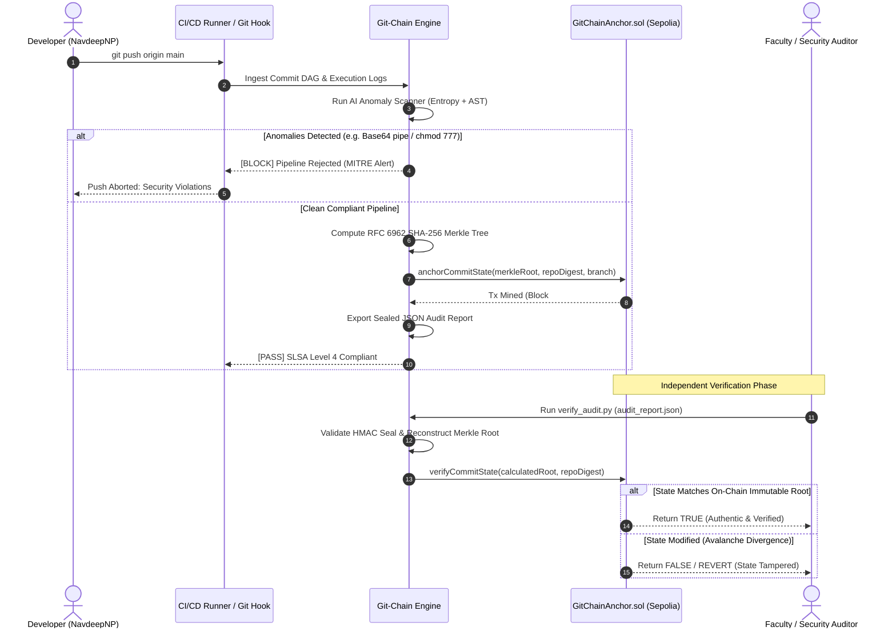

# Git-Chain: System Architecture & Technical Specifications

> **Architecture Documentation for DevSecOps Blockchain Immutability Framework**

---

## 1. High-Level System Architecture

```
+-----------------------------------------------------------------------------------------+
|                               DEVELOPER & RUNNER ENVIRONMENT                            |
+-----------------------------------------------------------------------------------------+
|   [Local Git Workspace]            [CI/CD Build Runner]         [GitHub Remote Repo]    |
|   - Commits & Parents              - Shell Commands             - GPG Signatures        |
|   - Author & Timestamps            - Stdout / Stderr Logs       - Protected Branches    |
|   - Diff Summaries                 - Exit Status Codes          - Webhook Events        |
+-----------------------------------------------------------------------------------------+
                                             |
                                    (Telemetry Ingestion)
                                             v
+-----------------------------------------------------------------------------------------+
|                                   GIT-CHAIN CORE ENGINE                                 |
+-----------------------------------------------------------------------------------------+
|  +--------------------------------+          +---------------------------------------+  |
|  | AI DevSecOps Anomaly Engine    |          | RFC 6962 SHA-256 Merkle Synthesizer   |  |
|  | - AST Tokenizer & Shannon Ent. |          | - Canonical Leaf Serialization        |  |
|  | - MITRE ATT&CK Matrix Matcher  |          | - Pairwise Binary Tree Construction   |  |
|  | - Base64 Shell Pipe Detector   |          | - 32-Byte Merkle Root Synthesis       |  |
|  | - Privilege Escalation Guard   |          | - O(log N) Inclusion Proof Generator  |  |
|  +--------------------------------+          +---------------------------------------+  |
+-----------------------------------------------------------------------------------------+
                        |                                       |
          (Verified / Clean State)                (Tamper-Evident Manifest)
                        v                                       v
+-----------------------------------+       +-----------------------------------------+
| ETHEREUM SEPOLIA SMART CONTRACT   |       | INDEPENDENT AUDIT VERIFIER              |
+-----------------------------------+       +-----------------------------------------+
| Contract: GitChainAnchor.sol      |       | Script: verify_audit.py                 |
| Function: anchorCommitState()     |       | - Document HMAC-SHA256 Seal Validation  |
| - 1x SSTORE (bytes32 MerkleRoot)  |       | - Raw Leaf Recalculation                |
| - Gas: ~48,219 units              |       | - Full Merkle Tree Rebuilding           |
| - Event: CommitStateAnchored      |       | - Zero-Knowledge Inclusion Proof Check  |
+-----------------------------------+       +-----------------------------------------+
```

---

## 2. Sequence Diagram: Build, Anchor, and Verify Lifecycle



---

## 3. Data Flow Diagram (DFD Level 1)

```
[Developer Commits] -----> (1.0 Ingest DAG) -------> [Commit Node Buffer]
                                                             |
[CI Runner Logs] --------> (2.0 Parse Logs) -------> [Log Line Buffer]
                                                             |
                                                             v
                                                    (3.0 AI Anomaly Scan)
                                                             |
                                                     [Security Finding]
                                                             |
                                             +---------------+---------------+
                                             |                               |
                                      (If Clean)                      (If Malicious)
                                             |                               |
                                             v                               v
                                  (4.0 Merkle Synthesizer)        (Abort & Raise Alert)
                                             |
                                      [Merkle Root]
                                             |
                                             +---------------+
                                             |               |
                                             v               v
                             (5.0 EVM Anchoring)     (6.0 Audit Manifest Export)
                                     |                       |
                                     v                       v
                         [Ethereum Sepolia Ledger]    [Tamper-Proof JSON]
```

---

## 4. Cryptographic Proof Complexity

| Operation | Complexity | Description |
|---|---|---|
| **Leaf Serialization** | $O(N)$ | Deterministic byte canonicalization across $N$ commits and logs. |
| **Merkle Tree Construction** | $O(N)$ | Pairwise SHA-256 double-hashing up to root node. |
| **Inclusion Proof Generation** | $O(\log N)$ | Collecting sibling digests along height $h = \lceil \log_2 N \rceil$. |
| **Inclusion Proof Verification** | $O(\log N)$ | Sequential hashing of $h$ proof steps against root. |
| **On-Chain State Storage** | $O(1)$ | Exactly one 32-byte `bytes32` write in smart contract storage. |
